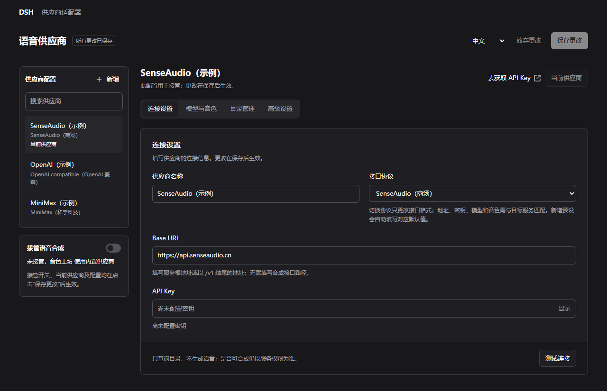

# 供应商适配器

`dsh-speech-provider-adapter` 是配合 **音色工坊（`dsh-xiaomi-tts`）** 使用的 DSH Web **示例插件项目**，用于演示自定义语音供应商的接入、配置管理与语音合成接管。

> 本项目提供适配思路和示例实现，**不保证实际使用效果、供应商兼容性或服务稳定性**。预设协议、模型和音色不代表已经过完整实测；实际可用性、音质、延迟和费用以目标供应商的接口、账号权限及实际调用结果为准，请自行验证。

## 项目分工

- **供应商适配器**：管理供应商名称、Base URL、API Key、接口协议、模型与音色目录，调用上游接口生成音频。
- **音色工坊**：提供模型与音色选择、试听、朗读、播放控制、历史、下载和渠道联动。

当前包含 SenseAudio（商汤）、OpenAI compatible（OpenAI 兼容）、MiniMax（稀宇科技）、SiliconFlow（硅基流动）、ElevenLabs、Fish Audio、Alibaba Cloud Bailian（阿里云百炼）和 Tencent Cloud（腾讯云）的示例适配，支持多套供应商配置、目录查询与手动补充、完整音频和 HTTP PCM 流式。不同服务的兼容情况需要分别调试；目录查询成功不代表语音合成一定可用。

新增预设依据官方文档整理，未使用真实账号实测。硅基流动预填 CosyVoice2 系统音色；ElevenLabs 可刷新账号音色；Fish Audio 需要刷新工作区音色或手动填写参考音色 ID。各服务的采样率、鉴权和目录差异见 [服务商预设说明](usage.md#服务商预设)。

阿里云百炼接入 Qwen-Audio-TTS HTTP 协议，需要业务空间地址与同地域 API Key；腾讯云接入 TextToVoice API 3.0，需要 SecretId / SecretKey，当前仅完整音频。两家的模型和音色先使用预设或手动维护，测试连接与目录刷新暂不可用；保存后通过音色工坊试听验证。

管理页使用轻量的原生 HTML、CSS 和 JavaScript。shadcn/ui 仅作为组件风格与交互组织的参考，不引入 shadcn、Tailwind 或前端框架依赖，不增加页面构建步骤。页面提供分区标签、供应商搜索、模型与音色搜索选择及统一保存操作。

## 设置页示意

以下为管理页的示例配置截图，不含真实密钥，仅展示界面与操作入口，不代表供应商实测结果。

在连接设置中管理供应商名称、协议、Base URL 与密钥，左侧显示供应商列表和实际接管状态。



## 安装

需要 Node.js 24.9+ 和 DSH Web。在同一个宿主实例中安装支持外部供应商的音色工坊和供应商适配器：

```powershell
dsh plugin --profile web add dsh-xiaomi-tts@latest
dsh plugin --profile web add dsh-speech-provider-adapter@latest
```

安装后，在 DSH 插件管理中启用供应商适配器组件，并按宿主提示重启或重新加载。源码本地链接和手动配置方法见 [安装与使用说明](usage.md#本地安装)。

如果之前使用本地链接安装供应商适配器，Windows 下可双击 [clear-local-links.cmd](clear-local-links.cmd) 清理适配器的安装记录和残留，再重新安装适配器。脚本会备份修改过的配置，不删除源码或供应商配置，也不清理音色工坊。

## 使用

1. 在 DSH 插件管理中打开供应商适配器的配置区，新增供应商并填写连接信息、模型和音色。
2. 设为当前供应商，启用接管并保存，再自行验证实际合成与播放效果。首次运行接管默认关闭。

配置方式、协议差异、保存机制与开发说明见 [usage.md](usage.md)。

## 免费试用与注册


以下按 2026 年 11 月 6 日查询到的官方信息整理，用于选择可测试的语音 API。额度、活动、账号权限和模型支持可能调整，以官方页面和账号控制台为准；有免费额度不代表本示例插件已完成适配或实测。

| 供应商 | API 免费使用条件与额度 | 官方注册入口 | 官方说明 |
| --- | --- | --- | --- |
| Fish Audio（鱼声） | 使用 `s2.1-pro-free` 模型，新账号无充值余额也可调用。免费条件仅适用于该模型，其他模型需单独确认计费。 | [注册并创建 API Key](https://fish.audio/app/developers/get-started/) | [API 快速开始](https://docs.fish.audio/developer-guide/getting-started/quickstart) |
| ElevenLabs | Free 套餐每月 10,000 credits，支持 API 调用；额度由多个产品共享，实际合成字数取决于模型，部分音色与功能受套餐限制。 | [注册账号](https://elevenlabs.io/app/sign-up) | [套餐额度](https://elevenlabs.io/pricing)、[API 计费说明](https://elevenlabs.io/docs/help-center/technical/how-much-does-it-cost-to-use-the-api) |
| Alibaba Cloud Bailian（阿里云百炼） | 部分 TTS 模型有新人额度，例如 `qwen3-tts-flash` 为 1 万字符，有效期 90 天。需完成实名认证并使用华北 2（北京）地域；不同模型额度独立，并非所有 TTS 模型均免费。 | [注册账号](https://account.aliyun.com/register/register.htm) | [模型价格与额度](https://help.aliyun.com/zh/model-studio/model-pricing)、[新人额度规则](https://help.aliyun.com/zh/model-studio/new-free-quota) |
| Tencent Cloud（腾讯云） | 基础/精品音色 800 万字符、大模型音色 10 万字符、超自然大模型 1.0 和 2.0 音色各 2 万字符。需在语音合成控制台领取，每账号限领一次，领取后 3 个月内有效；各类额度独立，仅适用于通用语音合成接口，不含长文本与播客接口。 | [注册账号](https://cloud.tencent.com/register) | [免费额度与计费规则](https://cloud.tencent.com/document/product/1073/34112) |

首次测试可优先选择 Fish Audio，创建 API Key 后，在适配器中选择对应协议、将模型明确设为 `s2.1-pro-free`，并填写可用的参考音色 ID，再用一句短文本试听。零余额调用付费模型可能返回 `402`，网页订阅额度与 API 计费也应分别确认。

百炼默认在免费额度用完后转为按量付费，仅测试时可提前开启官方提供的“免费额度用完即停”。MiniMax、SiliconFlow（硅基流动）和 SenseAudio 暂未确认到适用于本项目 TTS API 的固定免费额度，请以各自账号控制台为准。

## 欢迎 Issue 和 PR

**希望新增供应商、调试现有供应商或完善协议兼容性，欢迎提交 [Issue](https://github.com/ppy-web/dsh-speech-provider-adapter/issues) 或 [Pull Request（PR）](https://github.com/ppy-web/dsh-speech-provider-adapter/pulls)。** 也欢迎贡献接口文档、复现步骤、适配修复和使用经验。

提交 Issue 时，请尽量提供：

- 供应商名称、所用协议及公开接口文档。
- DSH、音色工坊和供应商适配器的版本或代码提交信息。
- 模型、音色 ID、复现步骤、预期结果与实际表现。
- 脱敏后的错误码、日志或请求与响应示例；请勿提交 API Key、访问令牌或私人服务凭据。

提交 PR 时，请说明适配范围、修改原因和实际验证情况。新增协议或供应商时，保留请求取消、音频格式约定、配置隔离和错误信息脱敏，并补充相应的使用说明与行为测试。未验证的功能请明确标注。

接受反馈与贡献不代表承诺支持所有供应商，也不承诺修复或合并时限。

## 许可证

[MIT](LICENSE)
