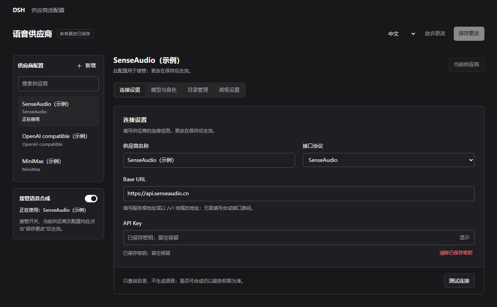
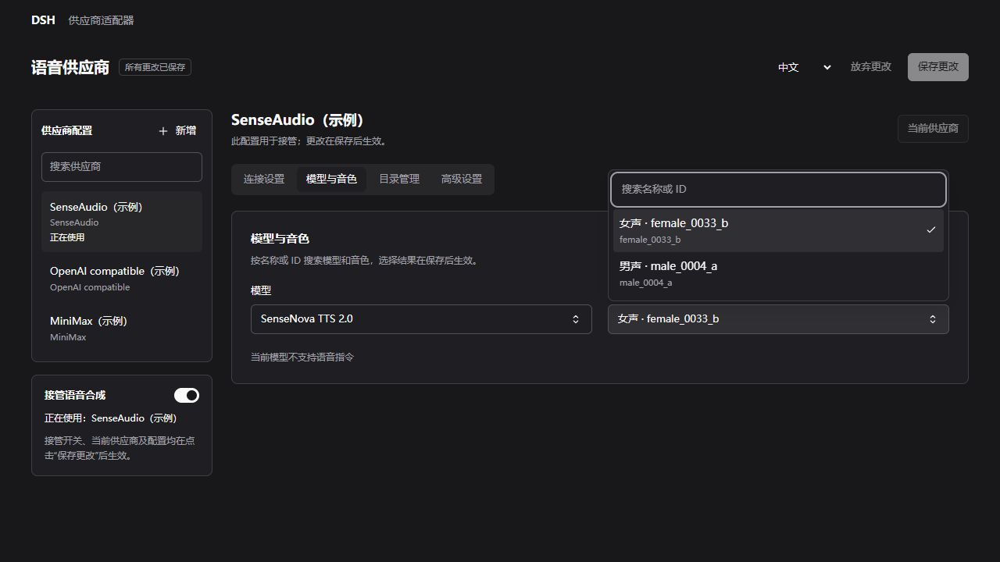

# 供应商适配器

`dsh-speech-provider-adapter` 是配合 **音色工坊（`dsh-xiaomi-tts`）** 使用的 DSH Web **示例插件项目**，用于演示自定义语音供应商的接入、配置管理与语音合成接管。

> 本项目提供适配思路和示例实现，**不保证实际使用效果、供应商兼容性或服务稳定性**。预设协议、模型和音色不代表已经过完整实测；实际可用性、音质、延迟和费用以目标供应商的接口、账号权限及实际调用结果为准，请自行验证。

## 项目分工

- **供应商适配器**：管理供应商名称、Base URL、API Key、接口协议、模型与音色目录，调用上游接口生成音频。
- **音色工坊**：提供模型与音色选择、试听、朗读、播放控制、历史、下载和渠道联动。

当前包含 SenseAudio（商汤）、OpenAI compatible（OpenAI 兼容）、MiniMax（稀宇科技）、SiliconFlow（硅基流动）、ElevenLabs、Fish Audio、Alibaba Cloud Bailian（阿里云百炼）和 Tencent Cloud（腾讯云）的示例适配，支持多套供应商配置、目录查询与手动补充、完整音频和 HTTP PCM 流式。不同服务的兼容情况需要分别调试；目录查询成功不代表语音合成一定可用。

新增预设依据官方文档整理，未使用真实账号实测。硅基流动预填 CosyVoice2 系统音色；ElevenLabs 可刷新账号音色；Fish Audio 需要刷新工作区音色或手动填写参考音色 ID。各服务的采样率、鉴权和目录差异见 [服务商预设说明](usage.md#服务商预设)。

阿里云百炼接入 Qwen-Audio-TTS HTTP 协议，需要业务空间地址与同地域 API Key；腾讯云接入 TextToVoice API 3.0，需要 SecretId / SecretKey，当前仅完整音频。两家的模型和音色先使用预设或手动维护，测试连接与目录刷新暂不可用；保存后通过音色工坊试听验证。

管理页使用轻量的原生 HTML、CSS 和 JavaScript。shadcn/ui 仅作为组件风格与交互组织的参考，不引入 shadcn、Tailwind 或前端框架依赖，不增加页面构建步骤。页面提供分区标签、供应商搜索、模型与音色搜索选择及统一保存操作。

## 设置页示意

以下为管理页的示例配置截图，不含真实密钥，仅展示界面与操作入口，不代表供应商实测结果。

**连接设置**：管理供应商名称、协议、Base URL 与密钥，左侧显示供应商列表和实际接管状态。

**模型与音色**：通过分区标签进入选择区，展开选择器后可按名称或 ID 搜索模型、音色。

## 使用

需要 Node.js 24.9+、DSH Web，以及具备外部供应商接管接口的音色工坊版本。两个插件需安装在同一宿主实例中。

1. 按照 [安装与使用说明](usage.md#本地安装) 安装音色工坊和供应商适配器。
2. 在 DSH 插件管理中打开供应商适配器的配置区，新增供应商并填写连接信息、模型和音色。
3. 设为当前供应商，启用接管并保存，再自行验证实际合成与播放效果。首次运行接管默认关闭。

配置方式、协议差异、保存机制与开发说明见 [usage.md](usage.md)。

## 欢迎 Issue 和 PR

**希望新增供应商、调试现有供应商或完善协议兼容性，欢迎提交 [Issue](https://github.com/ppy-web/dsh-speech-provider-adapter/issues) 或 [Pull Request（PR）](https://github.com/ppy-web/dsh-speech-provider-adapter/pulls)。** 也欢迎贡献接口文档、复现步骤、适配修复和使用经验。

提交 Issue 时，请尽量提供：

- 供应商名称、所用协议及公开接口文档。
- DSH、音色工坊和供应商适配器的版本或代码提交信息。
- 模型、音色 ID、复现步骤、预期结果与实际表现。
- 脱敏后的错误码、日志或请求与响应示例；请勿提交 API Key、访问令牌或私人服务凭据。

提交 PR 时，请说明适配范围、修改原因和实际验证情况。新增协议或供应商时，保留请求取消、音频格式约定、配置隔离和错误信息脱敏，并补充相应的使用说明与行为测试。未验证的功能请明确标注。

接受反馈与贡献不代表承诺支持所有供应商，也不承诺修复或合并时限。

## 许可证

[MIT](LICENSE)
