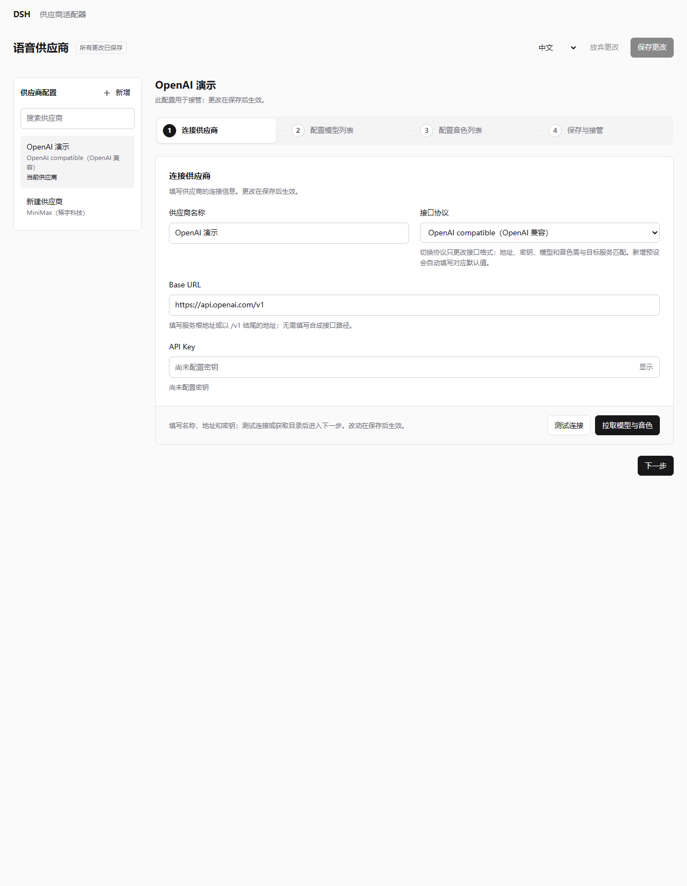
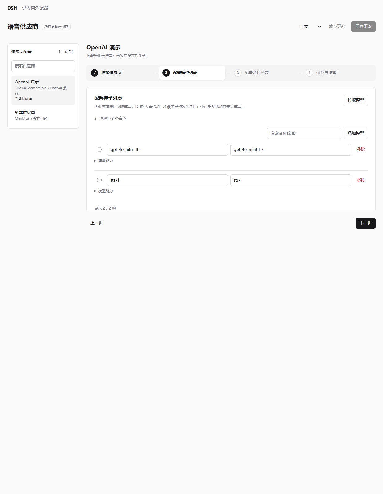
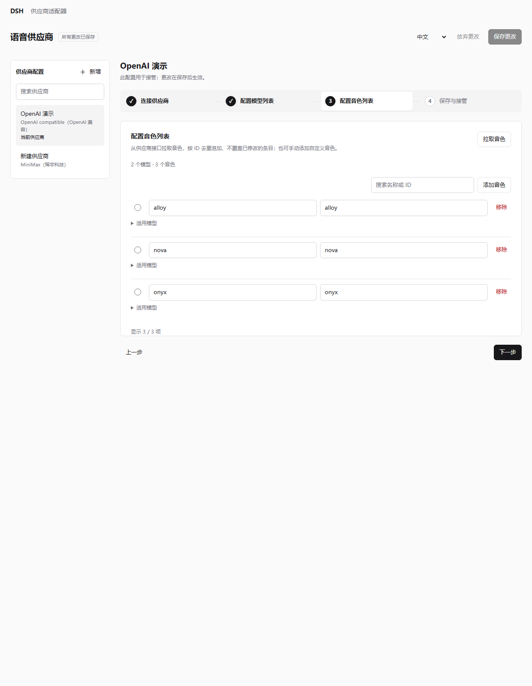
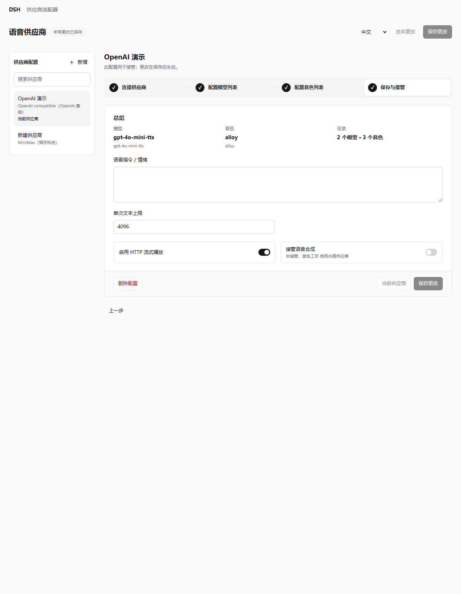

# 供应商适配器

`dsh-speech-provider-adapter` 是配合 **音色工坊（`dsh-xiaomi-tts`）** 使用的 DSH Web **示例插件项目**，用于演示自定义语音供应商的接入、配置管理与语音合成接管。

> 本项目提供适配思路和示例实现，**不保证实际使用效果、供应商兼容性或服务稳定性**。预设协议、模型和音色不代表已经过完整实测；实际可用性、音质、延迟和费用以目标供应商的接口、账号权限及实际调用结果为准，请自行验证。

## 项目分工

- **供应商适配器**：管理供应商名称、Base URL、API Key、接口协议、模型与音色目录，调用上游接口生成音频。
- **音色工坊**：提供模型与音色选择、试听、朗读、播放控制、历史、下载和渠道联动。

当前包含 SenseAudio（商汤）、OpenAI compatible（OpenAI 兼容）、MiniMax（稀宇科技）、SiliconFlow（硅基流动）、ElevenLabs、Fish Audio、Alibaba Cloud Bailian（阿里云百炼）、Tencent Cloud（腾讯云），以及音色工坊内置的 Xiaomi MiMo TTS（小米）、豆包 Seed TTS（火山引擎）、Breeze Blue TTS 及完全自定义本地模型（Custom local model）的示例适配，支持多套供应商配置、目录查询与手动补充、完整音频和流式播放。不同服务的兼容情况需要分别调试；目录查询成功不代表语音合成一定可用。

新增预设依据官方文档整理，未使用真实账号实测。硅基流动预填 CosyVoice2 系统音色；ElevenLabs 可刷新账号音色；Fish Audio 需要刷新工作区音色或手动填写参考音色 ID。各服务的采样率、鉴权和目录差异见 [服务商预设说明](usage.md#服务商预设)。

阿里云百炼接入 Qwen-Audio-TTS HTTP 协议，需要业务空间地址与同地域 API Key；腾讯云接入 TextToVoice API 3.0，需要 SecretId / SecretKey，当前仅完整音频。两家的模型和音色先使用预设或手动维护，测试连接与目录刷新暂不可用；保存后通过音色工坊试听验证。小米 MiMo 走 OpenAI 兼容 chat/completions（`sk-` / `tp-` 密钥），Breeze Blue 走 `xi-api-key` 二进制音频，豆包 Seed 走 WebSocket 双向流（`ark-` 密钥自动改用 agent-plan 地址）；三者都使用内置预设目录，并支持完整音频与流式播放。自定义本地模型协议默认指向本地 OpenAI 风格的 `/audio/speech`，只需本地 Base URL（API Key 可选），并在“高级选项”中支持自定义请求方法、路径、请求头、JSON 请求体模板、请求体编码（JSON / 表单）、取音方式与音频格式；连接步骤还可“探测本地端口”自动发现本机服务，详见 [自定义本地模型](usage.md#自定义本地模型)。

管理页使用轻量的原生 HTML、CSS 和 JavaScript。shadcn/ui 仅作为组件风格与交互组织的参考，不引入 shadcn、Tailwind 或前端框架依赖，不增加页面构建步骤。页面提供四步配置流程（连接供应商 → 配置模型列表 → 配置音色列表 → 保存与接管）、供应商搜索，模型与音色从接口拉取（去重追加）或手动补充，以及统一保存操作；左侧提供全局接管按钮（统一控制所有供应商，按钮底色示意开启/关闭）。

## 设置页示意

以下为管理页的示例配置截图，不含真实密钥，仅展示界面与操作入口，不代表供应商实测结果。

**连接供应商**：填写供应商名称、协议、Base URL 与密钥，即可测试连接或“拉取模型与音色”。

**配置模型与音色**：从供应商接口拉取列表（按 ID 去重追加、保留已修改条目），也可手动添加自定义条目；每行用单选项标记当前使用的模型/音色。

**保存与接管**：确认模型与音色，调整语音指令与限制，设为当前供应商并开启接管，保存后生效。

## 使用

需要 Node.js 24.9+、DSH Web，以及具备外部供应商接管接口的音色工坊版本。两个插件需安装在同一宿主实例中。

1. 按照 [安装与使用说明](usage.md#安装) 安装音色工坊和供应商适配器。
2. 在 DSH 插件管理中打开供应商适配器的配置区，新增供应商并填写连接信息、模型和音色。
3. 设为当前供应商，启用接管并保存，再自行验证实际合成与播放效果。首次运行接管默认关闭。

配置方式、协议差异、保存机制与开发说明见 [usage.md](usage.md)。

## 官方文档链接

- **SenseAudio（商汤）**：[合成](https://docs.senseaudio.cn/api-reference/endpoint/tts/synthesize.md) · [模型列表](https://docs.senseaudio.cn/api-reference/endpoint/models/list.md) · [音色列表](https://docs.senseaudio.cn/api-reference/endpoint/voice/list.md)
- **OpenAI compatible（OpenAI 兼容）**：[Speech 合成](https://developers.openai.com/api/reference/resources/audio/subresources/speech/methods/create)
- **MiniMax（稀宇科技）**：[合成](https://platform.minimax.io/docs/api-reference/speech-t2a-http) · [音色管理](https://platform.minimax.io/docs/api-reference/voice-management-get)
- **SiliconFlow（硅基流动）**：[合成](https://docs.siliconflow.cn/docs/api/audio-speech-post) · [音色与格式](https://docs.siliconflow.cn/docs/userguide/capabilities/text-to-speech)
- **ElevenLabs**：[合成](https://elevenlabs.io/docs/api-reference/text-to-speech/convert) · [流式](https://elevenlabs.io/docs/api-reference/text-to-speech/stream) · [音色目录](https://elevenlabs.io/docs/api-reference/voices/search)
- **Fish Audio**：[合成](https://docs.fish.audio/api-reference/endpoint/openapi-v1/text-to-speech) · [音色目录](https://docs.fish.audio/api-reference/endpoint/model/list-models)
- **Alibaba Cloud Bailian（阿里云百炼）**：[合成](https://help.aliyun.com/zh/model-studio/qwen-audio-tts-http-api) · [音色列表](https://help.aliyun.com/zh/model-studio/qwen-audio-tts-voice-list)
- **Tencent Cloud（腾讯云）**：[合成](https://cloud.tencent.com/document/api/1073/37995) · [签名方法](https://cloud.tencent.com/document/api/213/30654) · [音色列表](https://cloud.tencent.com/document/product/1073/92668)
- **Xiaomi MiMo TTS（小米）**：[音色工坊文档](https://ppy-web.github.io/dsh-plugin-xiaomi-mimo-tts/)
- **豆包 Seed TTS（火山引擎）**：[音色列表](https://docs.volcengine.com/docs/DoubaoVoice/Tonelist-1?lang=zh)
- **Breeze Blue TTS**：[音色库](https://breezeblue.ai/zh/voice-library)

## 欢迎 Issue 和 PR

**希望新增供应商、调试现有供应商或完善协议兼容性，欢迎提交 [Issue](https://github.com/ppy-web/dsh-speech-provider-adapter/issues) 或 [Pull Request（PR）](https://github.com/ppy-web/dsh-speech-provider-adapter/pulls)。** 也欢迎贡献接口文档、复现步骤、适配修复和使用经验。

提交 Issue 时，请尽量提供：

- 供应商名称、所用协议及公开接口文档。
- DSH、音色工坊和供应商适配器的版本或代码提交信息。
- 模型、音色 ID、复现步骤、预期结果与实际表现。
- 脱敏后的错误码、日志或请求与响应示例；请勿提交 API Key、访问令牌或私人服务凭据。

提交 PR 时，请说明适配范围、修改原因和实际验证情况。新增协议或供应商时，保留请求取消、音频格式约定、配置隔离和错误信息脱敏，并补充相应的使用说明与行为测试。未验证的功能请明确标注。

接受反馈与贡献不代表承诺支持所有供应商，也不承诺修复或合并时限。

## 许可证

[MIT](LICENSE)
