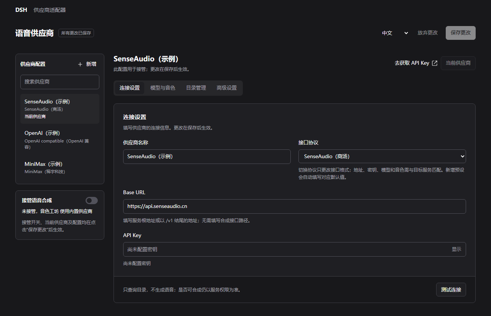

# 供应商适配器

为 [音色工坊](https://github.com/ppy-web/dsh-plugin-xiaomi-mimo-tts) 接入第三方和本地语音合成服务，统一管理供应商、模型和音色。

## 安装

需要 Node.js 24.9+ 和 DSH Web：

```powershell
dsh plugin --profile web add dsh-xiaomi-tts@latest
dsh plugin --profile web add dsh-speech-provider-adapter@latest
```

在插件管理中启用适配器，添加供应商并填写密钥，保存后开启接管。支持的服务及详细配置见 [使用说明](usage.md)。



[反馈问题](https://github.com/ppy-web/dsh-speech-provider-adapter/issues) · [MIT 许可证](LICENSE)
