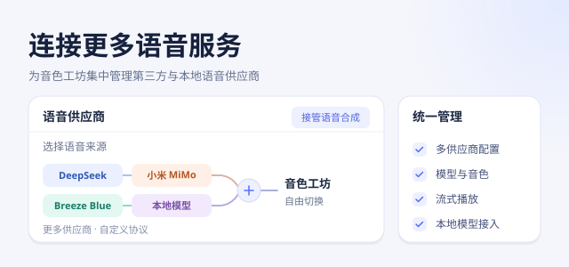

[README · 安装与使用](https://github.com/ppy-web/dsh-speech-provider-adapter#readme)

### 🔔 点击链接快速注册

📌[硅基流动](https://cloud.siliconflow.cn/i/DhJESocy) ·📌 [Breeze Blue](https://breezeblue.ai/zh?code=JHKLSJ) ·📌 [Fish Audio](https://fish.audio/?aff=EYEI4TKZPE26I) ·📌 [小米 MiMo](https://platform.xiaomimimo.com?ref=GQDDDU) ·📌 [ElevenLabs](https://try.elevenlabs.io/ongth4qh6gaw) ·📌 [腾讯云](https://curl.qcloud.com/xmLaElOV) ·📌 [豆包语音 API Key](https://console.volcengine.com/speech/new/setting/apikeys?projectName=default) ·📌 [阿里云百炼](https://www.aliyun.com/minisite/goods?userCode=h229osnq) ·📌 [SenseAudio API Key](https://senseaudio.cn/api-platform/api-key) ·📌 [DeepSeek API Key](https://platform.deepseek.com/api_keys) ·📌 [MiniMax API Key](https://platform.minimax.io/console/keys) ·📌 [Google Cloud TTS](https://console.cloud.google.com/apis/library/texttospeech.googleapis.com) ·📌 [Inworld AI](https://platform.inworld.ai/) ·📌 [OpenAI API Key](https://platform.openai.com/api-keys)
